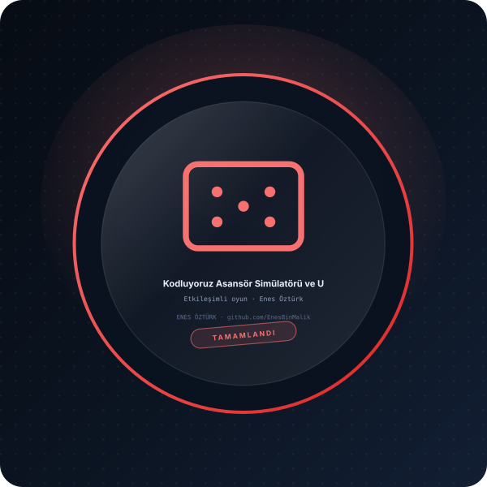

# Kodluyoruz Asansör Simülatörü ve UML Sınıf Diyagramı



> **Etkileşimli oyun · durum yönetimi** — tasarım ve geliştirme: **Enes Öztürk**

---

Kodluyoruz Sigorta Şirketi 12 katlı bina ve 5 asansörlü sistem için Nesne Yönelimli Programlama (OOP) ilkelerine uygun UML sınıf diyagramı ve interaktif simülatör. Tasarım: Enes Öztürk.

## Öne çıkanlar

- Oyun döngüsü, durum ve skor yönetimi
- Kullanıcı etkileşimi ve hamle doğrulama
- Kazanma/kaybetme koşulları
- Arayüzde animasyon ve geri bildirim

## Kurulum ve çalıştırma

```bash
npm install
npm run dev        # http://localhost:3000
```

| Komut | Not |
| --- | --- |
| `npm install` | bağımlılıklar |
| `npm run dev` | geliştirme sunucusu |
| `npm run build` | üretim derlemesi |

## Proje yapısı

```
├── index.html
├── package.json
├── docs/rozet.svg        # imza rozeti
└── src/                  # uygulama kaynakları
```

## Lisans

Bu proje **Enes Öztürk** tarafından geliştirilmiştir; tüm hakları saklıdır.
